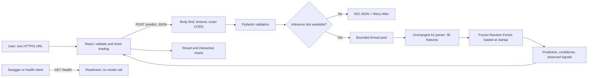

# DTDLINK — Assignment 3

**COS30049 · Session 7 · Group 5**

A React + FastAPI application that analyses URL text with the frozen Assignment 2
Random Forest. It never visits the submitted website, resolves its DNS, saves
submitted URLs or sends them to a third-party analysis service.

**Model scope:** class 1 combines phishing, malware and defacement; class 0 is
benign. The UI uses **Potentially dangerous** and **Likely legitimate**. It does
not identify an attack subtype. The brief asks for phishing/legitimate: the team
must confirm acceptance of this broader A2 model with its tutor. No tutor approval
is claimed here. Model accuracy is not assessed in A3, but this topic mismatch
still needs clarification.

## 1. Install and run

Requirements: **Python 3.12**, **Node.js 22.12 or later**, npm, and an Internet
connection for initial dependency installation. Inference, frontend assets and
`/docs` are local after installation. Python 3.9 from A2 cannot run this A3 stack.

Extract the source ZIP and open a terminal in the extracted project directory,
which contains `backend/`, `frontend/`, and this README. Do not execute from the
parent A2 directory. Paths below are relative to this directory.

### macOS / Linux

```bash
python3.12 -m venv backend/.venv
backend/.venv/bin/python -m pip install pip==26.3
backend/.venv/bin/python -m pip install -r backend/requirements.txt
backend/.venv/bin/python -m pip check
cd frontend
npm ci
npm run build
cd ..
backend/.venv/bin/python scripts/run.py
```

### Windows PowerShell

```powershell
py -3.12 -m venv backend/.venv
.\backend\.venv\Scripts\python.exe -m pip install pip==26.3
.\backend\.venv\Scripts\python.exe -m pip install -r backend/requirements.txt
.\backend\.venv\Scripts\python.exe -m pip check
Set-Location frontend
npm ci
npm run build
Set-Location ..
.\backend\.venv\Scripts\python.exe scripts/run.py
```

Open **http://127.0.0.1:5173/**. API documentation is at
**http://127.0.0.1:8000/docs**. Use `127.0.0.1` consistently: `localhost` is a
different browser origin. Press Ctrl+C in the launcher terminal to stop both
services. Windows commands are supplied for portability; verification on this
machine used macOS, not Windows.

Alternatively run two terminals:

```bash
# Terminal 1, from backend/: activate its .venv, then
python -m uvicorn app.main:app --host 127.0.0.1 --port 8000 --no-access-log --timeout-keep-alive 5
# Terminal 2, from frontend/
npm run preview
```

For development use `npm run dev` instead of preview. Production-style review uses
`npm run build` followed by `npm run preview`; Vite's preview server is for local
assessment, not an Internet production deployment. Both services bind to loopback.
No cloud deployment, account, API key or database is required.

### Configuration

- Backend: environment variable `DTDLINK_FRONTEND_ORIGIN`, default
  `http://127.0.0.1:5173`; exact origin only, no wildcard/trailing slash.
- Backend: `DTDLINK_MAX_CONCURRENT`, default 2, allowed 1–8. One Uvicorn worker is
  assumed; each process would have its own capacity budget and model.
- Frontend: `VITE_API_BASE_URL`, default `http://127.0.0.1:8000`. If changed, update
  `connect-src` in `frontend/vite.config.js` and rebuild.
- Backend `.env.example` documents variables; it is not loaded automatically.
  Frontend `.env.example` may be copied to `.env` before building. Never commit secrets.

The model is included in `backend/models/`. There is no download or training step.
It has SHA-256 `d4aa8ff332ab82c36e3befce1a0e74c336b25a07a19ee9012e489c56239cb586`.
Startup checks this trusted code constant **before** unsafe joblib deserialization,
then validates metadata, feature order and threshold. An attacker who can replace
both application code and model is outside that integrity guarantee.

## 2. Architecture and data flow



`frontend/src/App.jsx` owns the current input/result and at most 20 anonymous
session entries. Entries contain score, label, number, time and signal count,
**not URLs or hosts**. There is no localStorage, sessionStorage, cookie, database
or prediction cache. Only the current URL stays in component memory while shown.
Clear Session or page reload removes application session state. Browser memory,
OS swap, extensions and user screenshots are not controlled by this application.

`backend/app/main.py` loads the model once in FastAPI lifespan. Inference uses a
bounded executor; synchronous model work does not run on the event-loop thread.
The slot stays reserved until the actual work ends, including client cancellation.
There is no unbounded inference queue. Health requests do not use model slots.

`backend/src/dtdlink_ml/` contains byte-preserved copies of four A2 inference
modules. The model's numeric feature order, class mapping, threshold and feature
logic are unchanged. URLs are **not canonicalised or decoded before inference**.
Upgraded runtime compatibility was checked separately; the deployed A2 artifact was not refit. Later isolated A3 research fits are documented below and were not promoted.

## 3. API contract

| Method and endpoint | Purpose | Success |
|---|---|---|
| `GET /health` | Readiness, model version and active inference count | 200 |
| `GET /model-info` | Public scope, threshold and application limits | 200 |
| `POST /predict` | Analyse one submitted URL | 200 |
| `GET /docs` | Locally bundled Swagger UI; not a prediction endpoint | 200 |
| `GET /openapi.json` | Generated API schema with request/response examples | 200 |

Example requests (curl on macOS/Linux; use `curl.exe` on Windows):

```bash
curl http://127.0.0.1:8000/health
curl http://127.0.0.1:8000/model-info
curl -X POST http://127.0.0.1:8000/predict \
  -H 'Content-Type: application/json' \
  -d '{"url":"https://example.com/"}'
```

An illustrative real response is in `backend/examples/prediction.json` and
`/docs`. `example.com` is an input demonstration, not a promised benign prediction.
The score can be surprising because the frozen model has format bias.

All application errors share this structure, including 404/405, malformed JSON,
validation failures, invalid origin, body timeout, oversized body and model failure:

```json
{"error":{"code":"validation_error","message":"Check the submitted input.","fields":[{"field":"url","message":"Start the URL with http:// or https://."}]},"request_id":"a-server-generated-request-id"}
```

The real request ID is a fresh 32-character identifier, also returned in
`X-Request-ID`. Responses never contain exception stack traces or filesystem paths.
Validation failure messages do not echo submitted input. Status codes: 400 invalid
preflight/length, 403 unapproved Origin, 408 body timeout, 413 oversized body,
415 non-JSON prediction request, 422 invalid fields/JSON, 404/405 route/method,
500 inference failure and 503 exhausted capacity. HTTP parser errors that Uvicorn
rejects before ASGI are outside the application's JSON handler.

Input: one strict string, 1–2,048 characters, full HTTP(S) scheme, valid host and
port. Spaces, backslashes, malformed percent encoding and encoded/raw control
characters are rejected. The whole body is capped at 16 KiB, including chunked
requests; the complete body must arrive within five seconds. This is an explicit
application limit, not a claim that all valid Internet URLs fit 2,048 characters.
The backend, not just the frontend, enforces these limits. Same-origin requests
from the locally served API docs are accepted without granting a cross-origin
CORS permission to that API origin.

## 4. Results and visualisations

The model returns `dangerous_probability = p` for its combined positive class.
At `p >= 0.5` the label is Potentially dangerous; otherwise Likely legitimate.
Predicted-class confidence is `p` or `1-p` respectively. These estimates are not
calibrated probabilities of real-world harm. A 40–60% risk-score band triggers an
extra caution notice while retaining the model's real binary label; it is a UX
rule and not a calibrated uncertainty interval.

The result puts the actual hostname first and distinguishes it from text before
`@`. Exact input segments are highlighted using escaped React text nodes, never
raw HTML or clickable destination links. Expand **Understand the parts of this
URL** to read the connection type, sign-in text, host, optional port, page path,
parameters and fragment. Joining the API's `url_parts` reproduces the input
character-for-character, including case and empty `?`/`#` markers.
No display decoding is passed back into the model.

**Read the signs** pairs each observed pattern with actual evidence, a plain
language explanation and an actionable next step. There are 11 descriptive rules:
userinfo, numeric host, brand in a subdomain, limited look-alike characters,
encoding/internationalised host, account terms, many subdomains, length, HTTP,
custom port and brand words in a path/query. Evidence snippets are capped at
180 characters plus an ellipsis. The three highest-attention observations are
shown first; additional observations can be expanded. The count is not a risk
score and severity labels are presentation rules, not learnt model weights.

`backend/app/analysis.py` builds this offline explanation layer from the unchanged
A2 parser/features. `signals` now includes `evidence` and `action`; `url_parts`
contains ordered `{kind, text}` records. Base-domain grouping uses the bundled
public suffix list with the A2 parser's private-suffix setting, so it does not
verify ownership or identify accounts on shared hosting. HTTPS is described as
requested, not as a verified certificate or connection.

These observations are not SHAP values, causal explanations or the exact reasons
for a model decision. When a dangerous prediction has no matching pattern, the UI
states that mismatch rather than inventing a cause. A benign prediction still
shows any observed patterns; no patterns found does not establish safety.

Two different interactive visualisations:

1. **Current-result signals:** counts by attention level, with a severity filter
   and keyboard-accessible buttons that reveal the meaning of each observed signal.
2. **Session comparison:** model risk scores by anonymous check number, filterable
   by predicted label, with selectable check details and a labelled 50% threshold.

Tooltips, titles, legends, visible values and keyboard controls supplement color.
The layout is responsive; every form control is labelled, focus is visible and
motion respects reduced-motion preferences. Loading, success and error states,
client-side 404 and a React error boundary avoid a blank page during failures.

## 5. Threat model

The main attackers are a phisher seeking a benign-looking prediction and an
anonymous local API client trying to exhaust inference resources or inject active
content. They can bypass React, submit arbitrary HTTP bodies/headers directly,
send concurrent requests and vary URL syntax. They cannot legitimately overwrite
server code/model files. The assets are service availability, integrity of the
model/result and confidentiality of submitted URLs. The trust boundaries are the
browser-to-API boundary, validation-to-inference boundary and serialized-model
loading boundary.

Applicable threats: model evasion, application-level overload, unsafe model loading,
XSS through reflected input, insecure configuration and vulnerable dependencies.
Controls include backend validation, bounded work, text-only rendering, exact
CORS, hardened headers, no URL logging/storage, hash verification and dependency
scanning. CORS is a browser policy, **not authentication**; direct clients can omit
Origin. The capacity budget protects the shared model, but is not a per-user rate
limit and does not stop a distributed network attack.

SSRF is not exposed by the prediction path because it makes no outbound requests.
SQL injection is not applicable because there is no database. File-upload attacks
are not applicable because no files are accepted. Account access-control attacks
are not applicable because there are no accounts or records owned by users.
Command injection is not exposed because submitted input never enters a shell or
system command. Maintainer install/audit tools can use the Internet; they are not
called by the prediction endpoint. Testing is restricted to this team's local app.

### Selected section 2.7 defence 1: application-level denial of service (Advanced)

Mechanisms: bounded body and URL size, body-read deadline, off-event-loop inference,
a fixed two-worker budget and immediate 503/Retry-After for excess concurrent work.
A request cancellation does not prematurely free a still-running thread's slot.

Run the repeatable own-application comparison:

```bash
backend/.venv/bin/python scripts/dos_demo.py
# With both services running, exercise live TCP/HTTP bursts as well:
backend/.venv/bin/python scripts/live_smoke.py
```

The baseline is an intentionally blocking **test-only** FastAPI app; it is never
served by `scripts/run.py`. The defended case uses the production app factory.
The burst runs 32 actual model requests, repeated ten times. A separate controlled
slow-request case repeats inference 30 times inside a test-only predictor, repeated
five times. That second case is a scheduling stress test, **not evidence that one
particular URL naturally causes 30 inferences**. Both qualifications are necessary
when interpreting the video. Detailed measurements are in `evidence/dos-demo.json`.
The in-process ASGI transport measures event-loop responsiveness and rejection,
not TCP throughput or network-layer resilience. Unit tests additionally cover
client cancellation, chunked oversized bodies and slow body delivery.

Cost: overload causes legitimate requests to be rejected and retried; two workers
limit throughput. Health remains available, but an attacker may occupy every
prediction slot. A production deployment would also require connection limits,
transport timeouts, HTTPS and upstream protection.

### Selected section 2.7 defence 2: misconfiguration and dependencies (Intermediate)

No debug routes, URL access logging, wildcard CORS, unsafe HTML rendering or
prediction-time shell commands. CSP blocks arbitrary inline scripts/styles;
frontend Vite development uses a generated nonce for its refresh preamble. Backend
`/docs` serves pinned local Swagger UI assets. Headers include CSP, nosniff,
frame denial, no-referrer and API no-store. HSTS is intentionally absent on local
HTTP; a real HTTPS deployment needs it at the TLS boundary.

```bash
# From frontend/
npm audit --json
# From backend/ with its environment active
python -m pip_audit --format json --output ../evidence/pip-audit.json
```

The initial audit found known issues in the environment's bundled pip 25.0.1;
pip was upgraded to 26.3. ZAP initially reported `style-src unsafe-inline`;
that allowance was removed and a nonce used for development style tags. Keep the
before/after files in `evidence/`. A clean scan means no issue was found by that
scan, not a proof of complete security.

To reproduce ZAP, install an official cross-platform OWASP ZAP distribution and
Java 17+, run both project services, then:

```bash
backend/.venv/bin/python scripts/zap_scan.py --java /path/to/java --zap /path/to/zap.jar --active
```

The script only targets ports 5173 and 8000 on 127.0.0.1, starts its scanner on
127.0.0.1:8090, uses a temporary authenticated API/profile, limits the active scan
to one minute, saves findings and stops the scanner. Read
`docs/SECURITY_FINDINGS.md` for interpretation and scan coverage. A passive scan
alone is not a comprehensive penetration test; the active scan is deliberately
bounded. Scanner tools are not bundled in the submission ZIP.

### Section 2.8 advanced study

**Not claimed.** Preliminary offline evasion diagnostics exposed formatting and
encoding sensitivity, but no measured before/after defence study is submitted as
completed. This application does not change the trained model or claim the
normalisation issue has been fixed. Do not claim section 2.8 marks from the DoS
scheduling test or a few selected URL examples.

## URL-format investigation — model retained

The user authorised isolated A3 model experiments to investigate false positives.
The trace confirms the frontend/API display the frozen model's result correctly;
training-data format differs sharply by label. See
[the Vietnamese findings](docs/URL_FORMAT_FINDINGS_VI.md) and
[reproducible research](experiments/url_format/README.md).

The strongest aggregate text candidate reduced FPR from 88.00% to 11.36% on the
same 128,373 eligible validation records in API-style formatting, with dangerous
recall changing from 99.21% to 92.13%. It still falsely flagged 38.13% of labelled
benign homepages and scored the user's homepage examples highly. Root experts
and a further character-only view did not meet both FPR and recall criteria.
**No experimental model was promoted.** The running artifact, threshold 0.5,
metadata, API example, UI and security code remain unchanged. No whitelist or
inference-only scheme-removal workaround was introduced.

A2 data, models, results and source remain unchanged. Only train was used to fit;
validation selected/diagnosed candidates, and no A2 test outcomes were used. This
is exploratory validation reuse, not an unbiased final evaluation. Experimental
artifacts/caches stay local under `experiments/url_format/` and are excluded from
the source ZIP; code, plans, aggregate evidence and the active model are bundled.
Current backend checks: 68 tests pass, including the component-role contracts.
The unchanged frontend previously passed 17 tests and its production build.
This model-quality investigation does not claim completion of section 2.8.

The 6 November [component-role trial](experiments/url_format/field_roles/README.md)
also rejected all four new candidates. Separating URL parts alone did not meet
the joint false-positive/recall criteria; neither existing app was updated.

### Optional separate experimental preview

The workspace also contains `experimental-app/`, a review-only app using the
previously trained text candidate on ports **5174/8001**. It has independent
model/source/config and explicit Preview labels. The primary app on 5173/8000
and this ZIP still use the original A2 model. Google/GitHub homepage diagnostics
remain high in the experimental model; no fix or primary promotion is claimed.
The preview folder is excluded from the primary ZIP and packaged separately as
`session-07-group-5-assignment-3-experimental-preview.zip`. It is optional and
not required to install or run the primary submission.

## 6. Verification and packaging

```bash
# From backend/
python -m pytest
python -m pip check
# From frontend/
npm test
npm run build
# From the project root
backend/.venv/bin/python scripts/package_submission.py
```

`frontend/tests/app.spec.js` contains optional Playwright end-to-end scenarios;
install its Chromium browser and run `npm run test:e2e` with both services running
if that testing environment is available. The recorded verification distinguishes
executed browser checks from unexecuted platform/tool scenarios.

The package script produces a group-prefixed ZIP in the parent `submission/`
folder. It excludes environments, node_modules, caches, built frontend output,
scanner binaries, logs and local secrets. It includes model, source, locked
dependencies, README, API examples, test scripts, licence notices and selected
verification evidence. Runtime does not need any of the A2 training datasets.

See `evidence/verification.json` for actual checks and limits. Never infer that
A2's old 137 tests cover this new web app. A3 API and frontend tests are separate.

## 7. Submission and demonstration

The submission requires **source ZIP, video <=15 minutes, weekly minutes PDF and
contribution-form PDF**. There is no separate report. Source code alone is not a
complete submission. One member submits all group-prefixed files through Canvas.
The supplied deadline is 8 November 2026 at 23:59; confirm Canvas's timezone.

`docs/VIDEO_CHECKLIST.md` plans a demonstration of actual code, `/docs`, frontend
states, phone layout, threat model, attacks/defences and limitations. The team
must record its own presentation and verify playback. `docs/TEAM_DELIVERABLES.md`
lists the authentic minutes and contribution-form tasks. No meetings, signatures,
member agreement or tutor approval have been invented. The rubric allocates 7
points to section 2.7 while the prose says a cap of 8; this package does not
resolve that course-text discrepancy or promise a grade.

## Interface design update — 5 November 2026

The dark AI-inspired workspace uses UI UX Pro Max design guidance (reviewed
revision `b7d5353e0130feb8c5574ef1251f8a1db1873ccb`). Its local Python design-system
search informed the layout, semantic colour tokens, input composer and UX review.
The implementation uses the existing React, plain CSS and Lucide stack, with no
new runtime dependencies or external asset/font requests. Random Forest, API,
validation, labels, confidence meaning and session-only charts retain their original meaning. A later user-requested explanation enhancement extends the API presentation fields as documented in section 4.
Design decisions and third-party licence are in `design-system/dtdlink/`;
executed checks are in `evidence/ui-redesign-verification.json`.

## 8. Generative AI statement

OpenAI Codex assisted with requirements interpretation, model diagnostics,
architecture, implementation of the React/FastAPI application, tests, debugging,
security tooling, documentation and the UI UX Pro Max-guided interface redesign. The deployed A2 model and inference feature logic remain unchanged. Codex also
authored and ran isolated A3 experimental preprocessing, training and validation
scripts; no candidate met the full acceptance criteria and none was deployed. On 5 November 2026 the student
reported that the lecturer permits AI coding and that restrictive assignment
wording is legacy; this is student-reported clarification, not an independently
verified written course announcement. The team must accurately review this
statement, understand the implementation, explain its decisions and acknowledge
all assistance. This disclosure makes no claim that the team authored the code
without AI assistance.

## 9. References (Harvard style)

FastAPI (n.d.) *Lifespan events*. Available at: https://fastapi.tiangolo.com/advanced/events/ (Accessed: 5 November 2026).

Starlette (n.d.) *Thread pool*. Available at: https://www.starlette.io/threadpool/ (Accessed: 5 November 2026).

React (n.d.) *Common components: dangerously setting the inner HTML*. Available at: https://react.dev/reference/react-dom/components/common#dangerously-setting-the-inner-html (Accessed: 5 November 2026).

OWASP Foundation (n.d.) *OWASP Top 10*. Available at: https://owasp.org/www-project-top-ten/ (Accessed: 5 November 2026).

ZAP (n.d.) *ZAP API*. Available at: https://www.zaproxy.org/docs/api/ (Accessed: 5 November 2026).

Python Packaging Authority (n.d.) *pip-audit*. Available at: https://github.com/pypa/pip-audit (Accessed: 5 November 2026).

Berners-Lee, T., Fielding, R. and Masinter, L. (2005) *Uniform Resource Identifier (URI): Generic Syntax*. RFC 3986. Available at: https://www.rfc-editor.org/rfc/rfc3986 (Accessed: 5 November 2026).

Scikit-learn developers (n.d.) *Probability calibration*. Available at: https://scikit-learn.org/stable/modules/calibration.html (Accessed: 5 November 2026).

OpenAI (2026) *Codex*, AI coding assistance, 5 November. Use is described above.

Next Level Builder (n.d.) *UI UX Pro Max*. Available at: https://github.com/nextlevelbuilder/ui-ux-pro-max-skill (Accessed: 5 November 2026). Reviewed revision: b7d5353e0130feb8c5574ef1251f8a1db1873ccb.
